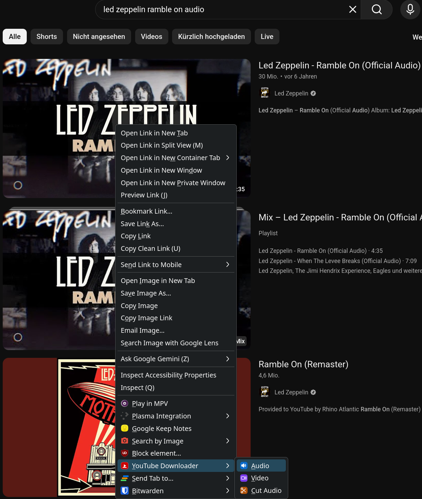

# Firefox YouTube Downloader

A Firefox add-on and local companion for sending YouTube pages, links, and
watch-page controls to `yt-dlp` for audio, video, or a selected audio cut. The
add-on supplies the interface; a small Native Messaging host and `yt-dlp` run
on your own computer. The companion is not bundled with the add-on, and the
extension sends nothing to a project-owned server.

This runs **the exact same `yt-dlp` + `ffmpeg` pipeline already running on
countless YouTube downloader websites** — but locally on your own machine, so it
is **more accessible** (integrated into the YouTube UI, right-click context
menu, and set-up-able global keyboard shortcuts), gives you **full control over
codecs and bitrates** (native Opus/M4A, MP3 `V0`/`V2`/`V5`/`320k`, M4A, Ogg,
FLAC, mono, cover art), and is **WAAAAY faster** (no upload queue, no ads, no
re-encoding traps, direct native stream download).

## Screenshots & interface overview




Four touchpoints (three to start a download, plus popup settings):

1. **Watch-page `[ Audio | Video | Cut ]` segmented pill** — injected next to
   YouTube's Like/Dislike controls on watch pages. Click **Audio** for the best
   native audio stream, **Video** for best video+audio, or **Cut** to pick start
   / end timestamps and encoding settings interactively in your terminal.
2. **Right-click `YouTube Downloader` ▸ `Audio` / `Video` / `Cut Audio`
   submenu** (context menu) — available on pages, frames, links, images,
   video/audio elements, and text selections. Works on cards in feeds and
   search results. If hover-autoplay covers a card, right-click the card
   itself; only the video element's own menu may show the browser defaults.
3. **Extension popup** — click the toolbar icon to check the companion
   connection, toggle automatic tagging, ReplayGain, cover art, channels, and
   long-audio routing, pick the audio format and MP3 quality, and choose the
   download folder.
4. **Global keyboard shortcuts & CLI** — assign system-wide hotkeys (for
   example `Meta+Alt+A` for audio, `Meta+Alt+V` for video, `Meta+Alt+C` for
   cut) to `~/.local/bin/yt-dlp-shortcut.sh audio|video|cut` under
   **Settings → Keyboard → Keyboard Shortcuts → Custom Shortcuts**
   (GNOME / Cinnamon) or **System Settings → Shortcuts → Custom Shortcuts**
   (KDE). Unlike the watch-page pill and context menu, which are scoped to
   YouTube, the shortcut script and CLI work on **almost any media site
   supported by `yt-dlp`** — YouTube, SoundCloud, Vimeo, Bandcamp, Twitch,
   and hundreds more.

> **Pin the extension to the toolbar:** click the **Extensions** puzzle-piece
> button in the top-right Firefox Navigation Toolbar, find **YouTube
> Downloader**, click its gear/pin icon and choose **Pin to Toolbar**. The
> popup is then one click away.

## Why prefer official audio uploads ("Art Tracks")

When a record label or distributor releases music on YouTube, YouTube
auto-generates an **Official Art Track**: a static-image video carrying the
studio master audio. You can recognize one by its description — it starts with
`Provided to YouTube by ...` (the distributor name) and ends with
`Auto-generated by YouTube.`

Prefer these uploads whenever they exist — append **`audio`** to your YouTube
search query (for example `led zeppelin rample on audio`, as in the context
menu screenshot above) to surface them. They give you two benefits:

1. **Best available audio quality.** The Art Track carries the highest-quality
   un-recompressed master audio stream straight from the distributor, rather
   than audio re-encoded from an uploaded music video. Combined with the
   default `best` (Native Opus / M4A) format below, this is the closest to the
   studio master that YouTube's servers hold.
2. **Rich automatic metadata.** Art Track descriptions are machine-readable and
   standardized, so `bin/ytdl_meta.py` extracts far more than a title: Album,
   exact `Released on:` date, original `℗` year, Label, Distributor, ISRC,
   Genre, Composer / Lyricist, Producer, Arranger, Conductor, Recording /
   Mixing / Mastering Engineers, Performers and their Instruments — and
   center-crops the video thumbnail to a square 1:1 `.webp` album cover instead
   of embedding a 16:9 letterboxed frame.

## Audio quality: native Opus / M4A vs. MP3 conversion, and Cut settings

**YouTube never stores native `.mp3` streams on its servers.** It stores audio
as **Opus (`format 251`, ~130–160 kbps VBR)** and **AAC (`format 140`,
`.m4a`, also used for past livestreams)**. Every "YouTube to MP3" converter
therefore performs a lossy-to-lossy transcode: it decodes the 160 kbps Opus
stream and re-encodes it as MP3.

That is why **`best` (Native Opus / M4A, the default)** is the best choice
whenever your playback device supports `.opus`: it downloads YouTube's native
stream with zero conversion and zero generation loss. Converting lossy 160
kbps Opus into 320 kbps MP3 cannot recover audio information destroyed by the
first encoding pass — it simply produces a ~2× larger file that has gone
through a second lossy encoding pass and sounds no better than the source.

Choose **MP3** only when you need it for compatibility — older car stereos, MP3
players, CDJs, and similar hardware. In that case the popup (or `config.json`)
offers four qualities:

| Quality | Meaning | When to use it |
| --- | --- | --- |
| `V0` (~245 kbps stereo / ~150 kbps mono VBR, LAME `-V 0` — **Recommended default**) | Transparent sweet spot | Default; audibly identical to the source for almost all listeners at the smallest size that achieves it. |
| `320k` (320 kbps stereo CBR → automatically scaled to `192 kbps` CBR when Mono is on) | Maximum fixed bitrate | Only if a picky device refuses VBR files. Larger, not better-sounding than `V0` from this source. |
| `V2` (~190 kbps stereo / ~120 kbps mono VBR) | Balanced | Smaller files where space matters and the source is speech or casual listening. |
| `V5` (~130 kbps stereo / ~85 kbps mono VBR — compact / speech) | Compact VBR | Speech, podcasts, or constrained storage. True psychoacoustic VBR, preferable to fixed `128k` CBR. |

The remaining **Audio Format** options, selectable in the Firefox popup or via
`audio_format` in `config.json` (`best`, `mp3`, `m4a`, `ogg`, `flac`;
`mp3_quality` defaults to `V0`):

- **`m4a`**: downloads YouTube's native AAC `.m4a` stream without re-encoding
  whenever available (`bestaudio[ext=m4a]/bestaudio`), converting via FFmpeg
  only if no native `.m4a` stream exists.
- **`ogg`** (Vorbis, quality `0`) and **`flac`**: convert via FFmpeg. Note that
  FLAC cannot restore quality lost in the source stream — it only preserves
  the decoded source losslessly in a larger file.

**`Cut Audio`** resolves channels once from the **Channels** setting below
(`Ask each time` prompts `(s)tereo or (m)ono` per download; non-interactive
runs fall back to stereo), then prompts interactively for start/end
timestamps. For Opus-family formats (`best`, `opus`) each cut also prompts
for bitrate (default **`128 kbps` VBR stereo**, **`75 kbps` mono**) and
application mode (**`audio`**, or **`voip`** for speech/podcasts, which favors
intelligibility at low bitrates). Cuts in MP3/M4A/Ogg/FLAC modes reuse the
configured format settings instead of prompting.

**Channels (`channel_mode`, Stereo by default):** `Stereo` keeps 2-channel
output; `Mono` downmixes to 1-channel mono (`-ac 1`) with psychoacoustic
bitrate scaling (roughly 60–65% of stereo, not half, because stereo codecs
already share mid/side information): native Opus `best` becomes Opus `96k`
VBR mono, the `opus` format becomes `75K` mono (vs `128K` stereo), MP3
`V0`/`V2`/`V5` scale automatically via LAME VBR while `320k` CBR maps to
`192k` CBR mono, and `m4a`/`ogg`/`flac` add `-ac 1` with their existing
quality settings. `Ask each time` prompts per download (`(s)tereo or (m)ono`,
defaulting to stereo); non-interactive runs fall back to stereo.

## What you need

- Firefox 115 or newer.
- The signed XPI from a GitHub Release or the [Firefox Add-ons listing](https://addons.mozilla.org/).
- The matching local companion installed with `install.sh` (Linux/macOS) or
  `install.ps1` (Windows).
- `yt-dlp` and FFmpeg installed locally. Python 3, Mutagen, and Pillow enable
  audio tagging and cover art; `rsgain` is optional and only used when
  ReplayGain is enabled.

The extension provides a YouTube right-click submenu, watch-page Audio/Video/
Cut controls, and a settings popup. It uses Firefox Native Messaging to pass a
user-selected mode and URL to the local companion. It does not download media
itself.

### Beginner-friendly dependency guide

In plain language, the three programs the companion needs are:

- **`yt-dlp`** — the free, open-source downloader that actually fetches the
  audio/video from the site. This project is only a convenient front-end for
  it; all media requests come from your own computer.
- **`ffmpeg`** — the free, open-source audio/video toolkit that converts
  between formats (MP3, M4A, Ogg, FLAC, Opus cuts) and trims cut sections.
- **`rsgain`** (optional) — a free ReplayGain tool that normalizes loudness
  across tracks. Only needed if you turn on ReplayGain in the popup; the
  popup checks whether `rsgain` is installed and blocks the toggle with
  install instructions if it is missing.

Where to get them is covered per-OS in
[Install the local companion](#install-the-local-companion): Debian 13.7
(GNOME) and LMDE 7 (Cinnamon) install everything with one `apt` line;
Arch/Fedora/openSUSE users substitute their package manager (`pacman`, `dnf`,
`zypper`); macOS users install via Homebrew (`brew install yt-dlp ffmpeg`,
plus `python`/`pillow` and `pip install mutagen`); Windows users install via
WinGet (`yt-dlp.yt-dlp`, `Gyan.FFmpeg.Shared`, `Python.Python.3.12`) and Scoop
for the optional `rsgain`.

> **Non-technical users:** you can copy-paste the prerequisites block for your
> OS below — or the output of `./install.sh --check-deps`, which never changes
> anything — into your preferred AI assistant (ChatGPT, Claude, Gemini,
> Copilot, …) and ask for step-by-step installation help tailored to your
> computer. All dependencies are standard, well-documented open-source tools,
> so any general-purpose assistant can walk you through installing them.

## Install the extension

Install the **signed** XPI from the latest GitHub Release using Firefox's
**Add-ons and themes → gear → Install Add-on From File…** action, or install
the Listed version from AMO if the store listing is available. An unsigned
local build is for development and cannot be permanently installed in normal
Firefox Release. Developers can build it with `./scripts/build-xpi.sh` and
temporarily load it from `about:debugging`. Maintainers sign releases with
`./scripts/sign-xpi.sh` (see [docs/AMO-PUBLISHING.md](docs/AMO-PUBLISHING.md));
the signed artifact is
`dist/firefox-youtube-downloader-signed.xpi`.

Project maintainers can create signed Unlisted release files or publish a
Listed AMO add-on by following [docs/AMO-PUBLISHING.md](docs/AMO-PUBLISHING.md).

## Install the local companion

Clone this repository, install the platform dependencies below, then run the
OS-specific companion installer from the repository directory. Each installer
has a dry-run default or a `--check-deps` command; neither installs operating
system packages automatically.

### Debian 13.7 (GNOME, Wayland)

```sh
sudo apt update
sudo apt install yt-dlp ffmpeg rsgain python3 python3-mutagen python3-pil \
  nodejs libnotify-bin wl-clipboard playerctl qt6-tools-dev-tools \
  xdg-utils desktop-file-utils
git clone https://github.com/Lakis01/Firefox-Youtube-Downloader-Plugin.git
cd Firefox-Youtube-Downloader-Plugin
./install.sh --check-deps
./install.sh --install --yes
```

GNOME normally includes `kgx` or `ptyxis`; `gnome-terminal` is only needed if
you want it as an additional terminal option. `wl-clipboard` supplies
Wayland clipboard/primary-selection support.

### LMDE 7 (Cinnamon, X11)

```sh
sudo apt update
sudo apt install yt-dlp ffmpeg rsgain python3 python3-mutagen python3-pil \
  nodejs gnome-terminal libnotify-bin xclip xsel playerctl \
  qt6-tools-dev-tools xdg-utils desktop-file-utils
git clone https://github.com/Lakis01/Firefox-Youtube-Downloader-Plugin.git
cd Firefox-Youtube-Downloader-Plugin
./install.sh --check-deps
./install.sh --install --yes
```

`xclip` or `xsel` supports clipboard access, and `gnome-terminal` is the
suggested terminal. ReplayGain is optional; omit `rsgain` if you do not use it.

### General Linux

Install `yt-dlp`, FFmpeg, Python 3 with Mutagen and Pillow, and a terminal
emulator. For the full shortcut integration, also install the clipboard and
MPRIS tools for your session: `wl-clipboard` on Wayland; `xclip` or `xsel` on
X11; and `playerctl` (or KDE's `qdbus6`). `rsgain` is optional. On Debian-based
systems, for example:

```sh
sudo apt install yt-dlp ffmpeg python3 python3-mutagen python3-pil \
  xdg-utils desktop-file-utils
# Optional features / desktop integrations:
sudo apt install rsgain wl-clipboard xclip xsel playerctl
git clone https://github.com/Lakis01/Firefox-Youtube-Downloader-Plugin.git
cd Firefox-Youtube-Downloader-Plugin
./install.sh --check-deps
./install.sh --install --yes
```

On Fedora, Arch, openSUSE, or another distribution, use its package manager and
package names instead. `./install.sh --check-deps` prints the detected desktop
session and Debian/LMDE package suggestions; it never runs the package manager.
The installer stages user-level binaries under `~/.local/bin`, the Firefox
Native Messaging manifest, and desktop shortcuts.

### macOS

Install Homebrew if needed, then install the command-line dependencies and
Python libraries. `rsgain` is optional:

```sh
brew install yt-dlp ffmpeg python pillow
python3 -m pip install --user mutagen
# Optional ReplayGain support, if available for your Homebrew setup:
brew install rsgain
git clone https://github.com/Lakis01/Firefox-Youtube-Downloader-Plugin.git
cd Firefox-Youtube-Downloader-Plugin
./install.sh --check-deps
./install.sh --install --yes
```

The macOS installer writes the Native Messaging manifest to
`~/Library/Application Support/Mozilla/NativeMessagingHosts/` and skips
Linux-only desktop entries. If Homebrew Python refuses a `--user`
package install because of its environment policy, install Mutagen using your
preferred Python package workflow for that Homebrew interpreter. Then install
the signed XPI from a GitHub Release or AMO in Firefox.

### Windows 10/11

Open PowerShell, install Python 3 and the local command-line dependencies, then
run the companion installer. Scoop or another trusted package source can be
used for optional `rsgain` if desired.

```powershell
winget install yt-dlp.yt-dlp
winget install Gyan.FFmpeg.Shared
winget install Python.Python.3.12
py -3 -m pip install mutagen Pillow
git clone https://github.com/Lakis01/Firefox-Youtube-Downloader-Plugin.git
cd Firefox-Youtube-Downloader-Plugin
.\install.ps1 --check-deps
.\install.ps1 --install --yes
```

The installer copies the Python host and helpers to
`%LOCALAPPDATA%\FirefoxYouTubeDownloader\bin`, writes its manifest and config
under `%LOCALAPPDATA%\FirefoxYouTubeDownloader`, registers the host for the
current Windows user, and builds `dist\firefox-youtube-downloader.xpi` without
requiring Bash. Install the **AMO-signed** XPI in Firefox separately; the local
installer's XPI is an unsigned build artifact. If Windows Terminal (`wt.exe`)
is installed, downloads open there; otherwise the host opens a new console.

## Configuration and installer behavior

The popup stores these options in the user's config file:

| Option | Fresh-install default | Meaning |
| --- | --- | --- |
| Download directory | `~/Music/Youtube Downloads` when yt-dlp has no config; otherwise use yt-dlp's configured path | Choose another directory or select `ytdlp-default`. |
| Automatic tagging | On | Extract description metadata and attach cover art to audio/cut downloads. |
| ReplayGain | Off | Run `rsgain` on finished audio/cut files. The toggle is blocked with install instructions when `rsgain` is not installed. |
| Audio format | `best` (Native Opus / M4A, no conversion) | `best`, `mp3`, `m4a`, `ogg`, or `flac`, selectable in the popup or via `audio_format` in `config.json`. `m4a` downloads the native AAC stream when available. |
| MP3 quality | `V0` (~245 kbps VBR, Recommended) | `V0`, `320k`, `V2`, or `V5`; shown only when the format is `mp3`. Mono scales `320k` to `192k` automatically. |
| Embed thumbnail picture | On | Download and embed cover art (`image/webp`, JPEG for M4A). Turn off to skip thumbnails entirely. |
| Convert thumbnail to JPEG | Off | Transcode cover art to `image/jpeg` for legacy hardware/car players that cannot render embedded WebP. |
| Channels | `Stereo` | `Stereo`, `Ask each time`, or `Mono` (`channel_mode` in `config.json`). `Mono` downmixes to 1-channel mono (`-ac 1`); native Opus `best` becomes `96k` mono and MP3 `320k` CBR becomes `192k`. |
| Route long audio to a separate folder | Off | When on, finished audio longer than `long_audio_minutes` (default `30`) moves to `long_audio_dir` (default `~/Podcasts`, with `~/Audiobooks` or a custom path). Ideal for podcasts and audiobooks. |

Linux/macOS use `~/.config/youtube-downloader/config.json` or the equivalent
under `$XDG_CONFIG_HOME`. Windows uses
`%LOCALAPPDATA%\FirefoxYouTubeDownloader\config.json` unless
`XDG_CONFIG_HOME` is explicitly set. The installers never create or modify an
existing yt-dlp config such as `~/.config/yt-dlp/config` or
`%APPDATA%\yt-dlp\config`.

On Linux and macOS, a plain `./install.sh` invocation is a no-write dry run;
`./install.sh --install` applies the install. On Windows,
`py -3 install.py` is the no-write dry run and
`py -3 install.py --install --yes` applies it (or use the PowerShell wrapper).
`--download-dir=ytdlp-default`, `--auto-tag=true|false`, and
`--rsgain=true|false` set values explicitly. Existing plugin configuration is
preserved unless an option is provided.

## Shortcuts and desktop integration

On Linux, the shortcut resolves a URL in this order: explicit argument,
primary selection, active media URL (MPRIS), then clipboard. It chooses a
supported terminal automatically; set `YTDL_TERMINAL` to select one. Because
the script delegates to `yt-dlp` directly, the same three commands work on
almost any media site `yt-dlp` supports (YouTube, SoundCloud, Vimeo,
Bandcamp, Twitch, and more) — not just YouTube. A GNOME
or Cinnamon custom keyboard shortcut can run:

```sh
~/.local/bin/yt-dlp-shortcut.sh audio
~/.local/bin/yt-dlp-shortcut.sh video
~/.local/bin/yt-dlp-shortcut.sh cut
```

Suggested bindings are `Meta+Alt+A` (audio), `Meta+Alt+V` (video), and
`Meta+Alt+C` (cut); pick unused combinations if those clash on your system.

On macOS the native host opens Terminal for the download and removes its
temporary launcher script after launch. On Windows it prefers Windows Terminal
and falls back to a separate console window.

KDE users can assign the installed **YouTube Audio Download**, **YouTube Video
Download**, and **YouTube Interactive Cut Audio** launchers under **System
Settings → Shortcuts → Custom Shortcuts**. On GNOME or Cinnamon, add the three
commands above under **Settings → Keyboard → Keyboard Shortcuts → Custom
Shortcuts** and choose unused key combinations.

## Forking for Brave, Chrome, Edge & Safari — contributions welcome

Please feel free to fork this project or contribute — it would be appreciated
to build all extensions in this place — to also include Safari, Brave, Chrome,
Chromium, Edge, Vivaldi, or the browser of your choice. Pull requests that add
a browser shell while reusing the exact same Python companion
(`bin/yt-dlp-native-host.py`, `yt-dlp-shortcut.sh`, `yt-dlp-wrapper.py`) are
especially welcome.

Research results for building the extension for other browsers:

- **Chrome Web Store (Chrome, Brave, Edge, Vivaldi):** Google strictly bans
  YouTube downloader extensions from the official Chrome Web Store to protect
  YouTube. However, Brave, Chromium, Vivaldi, and Chrome all allow installing an
  unpacked folder or `.crx` via Developer Mode (`chrome://extensions` → Load
  unpacked), and share the exact same `chrome.runtime.sendNativeMessage` API.
- **Safari (macOS):** Apple's Mac App Store rejects YouTube downloader
  extensions under Guideline 5.2.3, but macOS users can convert `extension/`
  locally in one command (`xcrun safari-web-extension-converter extension/`)
  and run it in Safari with free local Xcode signing.

Technical porting notes (same architecture, only the browser shell changes):

- **Chromium-based browsers (Brave, Chrome, Edge, Vivaldi):** port
  `extension/` to `manifest_version: 3` — move `background.js` into a service
  worker, keep `menus`/`contextMenus` and `activeTab` usage, and swap
  `browser.runtime.sendNativeMessage` for `chrome.runtime.sendNativeMessage`
  (the background script already falls back to the `chrome` namespace).
  Install the same host manifest under the Chromium messaging directory
  instead of Firefox's, e.g. `~/.config/BraveSoftware/Brave-Browser/NativeMessagingHosts/`
  or `~/.config/google-chrome/NativeMessagingHosts/` for the matching channel,
  keeping the host ID `firefox_youtube_downloader` (or rename it consistently
  in both the manifest and the extension).
- **Safari:** run Apple's converter on the shared source
  (`xcrun safari-web-extension-converter extension/`), then wire the converted
  target to the same Python host via Safari's native-messaging bridge. The
  download, tagging, and cut pipeline (`yt-dlp`, FFmpeg, `ytdl_meta.py`) is
  browser-agnostic and needs no changes.

In all cases the local companion, config schema, and CLI (`yt-dlp-shortcut.sh`
audio/video/cut) stay identical; only the browser shell and the messaging-host
registration path differ.

## Uninstall & rollback

The Linux installer keeps timestamped `.bak.*` copies beside replaced files.
To roll back, restore those files and remove only the Native Messaging manifests
that did not exist before the install. It does not modify Firefox profiles or
yt-dlp configuration.

## Troubleshooting

- **Popup says the companion is unavailable:** confirm the Native Messaging
  manifest and host path. Re-run the matching companion installer.
- **Download command is missing:** confirm `yt-dlp` and FFmpeg are on `PATH`;
  open a new terminal after installing them.
- **Tagging fails:** verify Python can import Mutagen and Pillow. Disable
  automatic tagging in settings if you do not need it.
- **No ReplayGain stage:** install `rsgain` and turn its option on.
- **Terminal or clipboard fallback is unavailable on Linux:** install a
  supported terminal and the clipboard/MPRIS tool matching Wayland or X11.

## Verification

Run these checks from the repository root. Counts should be updated with the
suite if tests are added or removed:

```sh
python3 -m unittest discover -s tests -v  # 139 Python tests
bash tests/test_shortcut.sh               # 41 launcher/installer checks
node tests/test_firefox_extension.js
bash scripts/build-xpi.sh
bash scripts/sign-xpi.sh                  # requires AMO_JWT_ISSUER/AMO_JWT_SECRET
bash -n install.sh bin/yt-dlp-shortcut.sh scripts/build-xpi.sh scripts/sign-xpi.sh tests/test_shortcut.sh
desktop-file-validate desktop/*.desktop
./install.sh
python3 install.py
git diff --check
```

The Node fixture does not replace a final manual check in Firefox on each target
OS. Test a signed XPI, companion install, menu action, watch-page controls, and
popup settings before releasing.

## License

MIT License — see [LICENSE](LICENSE). Free & open source: use, modify, and
share freely, including forks for other browsers.
