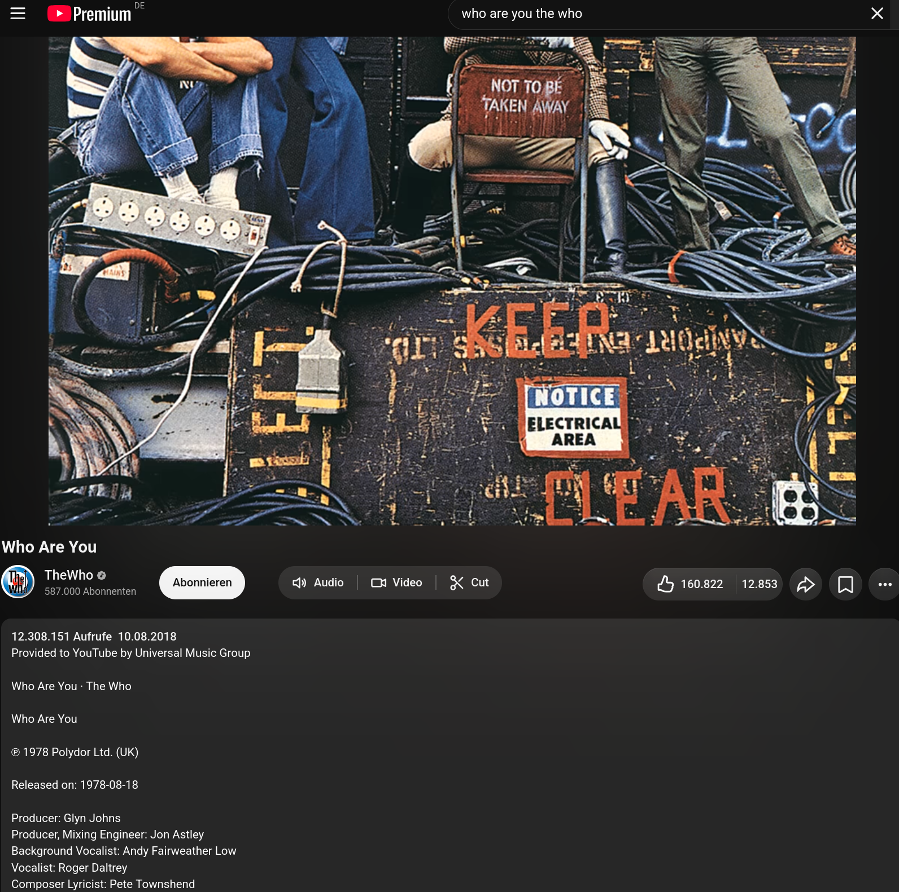
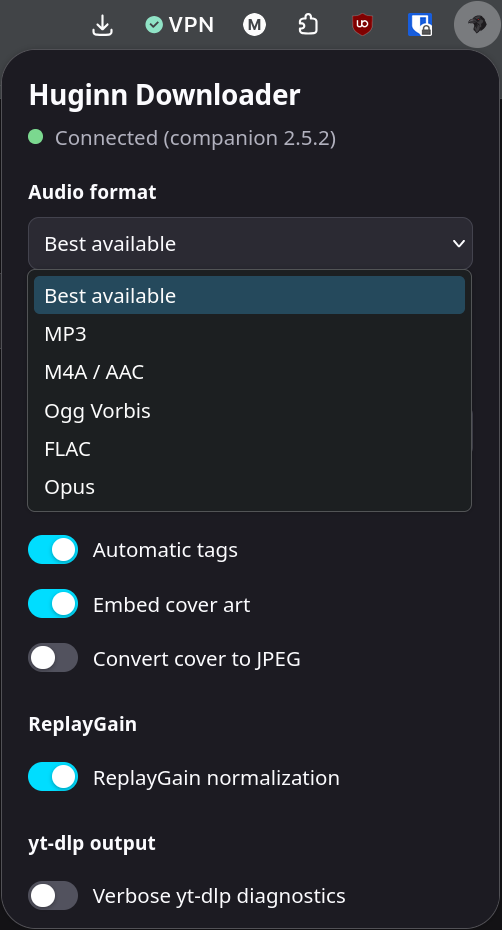

# Huginn Downloader

<p align="center">
  
</p>

Huginn Downloader is a Firefox extension and a separate local companion. Both
the Firefox extension and the local companion are required: the extension
provides the settings popup, YouTube watch-page controls, and browser context
menu; the companion connects Firefox to the local
`yt-dlp` backend, which fetches the media. The companion is not bundled with
the extension, and the extension sends nothing to a project-owned server.

`yt-dlp` and FFmpeg run locally on your computer: downloads go directly from
the source to your machine, without an upload queue or ads. Each action starts
an independent `yt-dlp` session, so you can run multiple audio, video, or cut
downloads in parallel without waiting for one download to finish before
starting the next. Huginn adds YouTube
watch-page controls, a right-click menu, and system keyboard shortcuts, with
choices for native Opus/M4A, forced Opus, MP3
(`V0`/`V2`/`V5`/`320k`), Ogg, FLAC, channels, and cover art. Speed depends on
the site, available formats, and your connection; native streams avoid an
extra conversion when they match your chosen settings.

## Screenshots & interface overview



The watch-page pill starts audio, video, or cut downloads without leaving
YouTube. The example is an official audio upload; its description shows the
standard metadata format used by automatic tagging.


Huginn adds Audio, Video, and Cut Audio actions to Firefox's context menu.
Custom keyboard shortcuts can run the local helper with the selected, active
media, or clipboard URL.



Clicking the pinned raven icon in Firefox's toolbar opens the Huginn Downloader
popup, showing live companion connection status alongside audio-format,
automatic-tagging, cover-art, ReplayGain, diagnostic, and folder settings.

Although the watch-page pill is YouTube-specific, the context menu and local
helper also work with other media sites supported by `yt-dlp`.

Four touchpoints (three to start a download, plus popup settings):

1. **Watch-page `[ Audio | Video | Cut ]` segmented pill** — injected next to
   YouTube's Like/Dislike controls on watch pages. Click **Audio** for the best
   native audio stream, **Video** for best video+audio, or **Cut** to pick start
   / end timestamps and encoding settings interactively in your terminal.
   When watching a playlist (`?list=...`), clicking **Audio** or **Video** asks
   whether to download **This video only** or the **playlist**, lets you check
   individual tracks directly in the side playlist panel with **Select all**,
   **Deselect all**, and a **Download** button in both the panel toolbar and
   dialog, and accepts `yt-dlp` `--playlist-items` ranges (`1-5, 8, 1:10:2`)
   synced two-way with the checkboxes (**Cut** stays single-track only and is
   hidden during batch selection).
2. **Right-click `Huginn Downloader` ▸ `Audio` / `Video` / `Cut Audio`
   submenu** (context menu) — available broadly on pages, frames, links,
   images, video/audio elements, and text selections, not just YouTube. On
   YouTube it works on cards in feeds and search results even when a
   hover-autoplay overlay covers a card. Right-clicking a playlist card or
   playlist URL with **Audio** or **Video** asks whether you want to **Download
   entire playlist**, **Download top song only**, or **Select items
   graphically** (opening the side/list checkboxes directly). Any safe HTTP(S)
   URL is accepted and handed to the local companion, so the menu works on any
   media site `yt-dlp` supports. Batch downloads render a live `pacman`-style
   overall item counter and percentage progress bar in the terminal during
   download and multi-track audio finalization.
 3. **Extension popup** — click the toolbar icon to manage audio/video folders,
     formats, tagging, artwork, ReplayGain, channels, and long-audio routing.
4. **Global keyboard shortcuts & CLI** — assign system-wide hotkeys (for
   example `Meta+Alt+A` for audio, `Meta+Alt+V` for video, `Meta+Alt+C` for
   cut) to `~/.local/bin/yt-dlp-shortcut.sh audio|video|cut` under
   **Settings → Keyboard → Keyboard Shortcuts → Custom Shortcuts**
   (GNOME / Cinnamon) or **System Settings → Shortcuts → Custom Shortcuts**
   (KDE). The watch-page pill is YouTube-specific, while the context menu,
   the shortcut script, and the CLI work on **almost any media site
   supported by `yt-dlp`** — YouTube, SoundCloud, Vimeo, Bandcamp, Twitch,
   and hundreds more.

> **Pin Huginn Downloader to the toolbar** for one-click access to its popup.
> The popup is where you choose download folders and formats and manage tagging,
> cover art, ReplayGain, channels, and other settings. Click your browser's
> **Extensions** puzzle-piece, find **Huginn Downloader**, then choose **Pin to
> Toolbar** from its menu.

## Tested desktop environments

Tested directly on **Firefox** and **Chromium** across:

- Arch Linux (CachyOS) with KDE Plasma
- Debian 13 with GNOME
- LMDE 7 with Cinnamon

Other compatible browsers supported by the extension build and Native Messaging
setup (should work identically, though not individually tested on every
release):

- **Gecko / Firefox family:** Firefox, LibreWolf, Zen Browser, Floorp, Waterfox
- **Chromium family (Manifest V3):** Chromium, Ungoogled Chromium, Brave, Vivaldi, Google Chrome, Microsoft Edge

## Why prefer official audio uploads ("Art Tracks")

When a record label or distributor releases music on YouTube, YouTube
auto-generates an **Official Art Track**: a static-image video carrying the
studio master audio. You can recognize one by its description — it starts with
`Provided to YouTube by ...` (the distributor name) and ends with
`Auto-generated by YouTube.`

Prefer these uploads whenever they exist — append **`audio`** to your YouTube
search query (for example `led zeppelin ramble on audio`, as in the context
menu screenshot above) to surface them. They give you two benefits:

1. **Best available audio quality.** The Art Track carries the highest-quality
   un-recompressed master audio stream straight from the distributor, rather
   than audio re-encoded from an uploaded music video. Combined with the
   default `best` (Native Opus / M4A) format below, this is the closest to the
   studio master that YouTube's servers hold.
2. **Rich automatic metadata.** Art Track descriptions are machine-readable and
   standardized, so `bin/ytdl_meta.py` extracts far more than a title: Album,
   exact `Released on:` date, original `℗` year, Label, Distributor, ISRC,
   Genre, Composer / Lyricist, Producer, Arranger, Conductor, Recording /
   Mixing / Mastering Engineers, Performers and their Instruments — and
   center-crops the video thumbnail to a square 1:1 `.webp` album cover instead
   of embedding a 16:9 letterboxed frame.

## Audio quality: native Opus / M4A vs. MP3 conversion, and Cut settings

**YouTube never stores native `.mp3` streams on its servers.** It stores audio
as **Opus (`format 251`, ~130–160 kbps VBR)** and **AAC (`format 140`,
`.m4a`, also used for past livestreams)**. Every "YouTube to MP3" converter
therefore performs a lossy-to-lossy transcode: it decodes the 160 kbps Opus
stream and re-encodes it as MP3.

That is why **`best` (Native Opus / M4A, the default)** is the best choice
whenever your playback device supports `.opus`: it downloads YouTube's native
stream with zero conversion and zero generation loss. Converting lossy 160
kbps Opus into 320 kbps MP3 cannot recover audio information destroyed by the
first encoding pass — it simply produces a ~2× larger file that has gone
through a second lossy encoding pass and sounds no better than the source.

Choose **MP3** only when you need it for compatibility — older car stereos, MP3
players, CDJs, and similar hardware. In that case the popup (or `config.json`)
offers four qualities:

| Quality | Meaning | When to use it |
| --- | --- | --- |
| `V0` (~245 kbps stereo / ~150 kbps mono VBR, LAME `-V 0` — **Recommended default**) | Transparent sweet spot | Default; audibly identical to the source for almost all listeners at the smallest size that achieves it. |
| `320k` (320 kbps stereo CBR → automatically scaled to `192 kbps` CBR when Mono is on) | Maximum fixed bitrate | Only if a picky device refuses VBR files. Larger, not better-sounding than `V0` from this source. |
| `V2` (~190 kbps stereo / ~120 kbps mono VBR) | Balanced | Smaller files where space matters and the source is speech or casual listening. |
| `V5` (~130 kbps stereo / ~85 kbps mono VBR — compact / speech) | Compact VBR | Speech, podcasts, or constrained storage. True psychoacoustic VBR, preferable to fixed `128k` CBR. |

The popup uses short format labels. These choices are also available through
`audio_format` in `config.json`; `mp3_quality` defaults to `V0`.

| Popup label | Format | Behavior |
| --- | --- | --- |
| Native (Opus / m4a) | `best` | Keep native Opus/M4A when possible without lossy re-encoding. |
| MP3 | `mp3` | Convert through FFmpeg for players that require MP3. |
| M4A / AAC (transcode if not natively available) | `m4a` | Prefer native AAC; convert through FFmpeg only when needed. |
| Ogg Vorbis | `ogg` | Convert through FFmpeg to Vorbis. |
| FLAC | `flac` | Convert through FFmpeg; it cannot restore quality lost in the source. |
| Opus (transcode if not natively available) | `opus` | Force Opus; copy native Opus when possible, otherwise convert through FFmpeg. |

More detail on forced Opus and AAC behavior:

- **`opus`**: forces Opus output — prefers `bestaudio[acodec=opus]/bestaudio/best`,
  copies the native Opus stream when stereo and available, and otherwise
  transcodes to Opus via FFmpeg (`--audio-quality 128K` stereo, `96K` mono).
  Cuts default to Opus at `128 kbps` VBR stereo / `75 kbps` mono.
- **`m4a`**: downloads YouTube's native AAC `.m4a` stream without re-encoding
  whenever available (`bestaudio[ext=m4a]/bestaudio/best`), converting via FFmpeg
  if no native `.m4a` stream exists or a mono downmix is requested.
- **`ogg`** (Vorbis, quality `0`) and **`flac`**: convert via FFmpeg. Note that
  FLAC cannot restore quality lost in the source stream — it only preserves
  the decoded source losslessly in a larger file.

### Audio extraction from other yt-dlp sites

Audio downloads prefer an audio-only stream (`bestaudio`). If an extractor has
only combined audio/video formats, the selector falls back to `best` and
FFmpeg extracts the audio track. This handles sources such as Dailymotion HLS
pages that offer MP4 A/V variants but no separate audio-only format. The
fallback may transfer a larger video-containing stream before extracting its
audio. Audio cuts use the same fallback; the final audio encoder maps only the
audio stream and any attached cover art, not the ordinary video stream.

This does not bypass a site's login, geography, DRM, or availability
restrictions. If a source still reports “Requested format is not available,”
update `yt-dlp` and inspect that URL with `yt-dlp --list-formats URL`; formats
vary by page and extractor version.

**`Cut Audio`** resolves channels once from the **Channels** setting below
(`Ask each time` prompts `(s)tereo or (m)ono` per download; non-interactive
runs fall back to stereo), then prompts interactively for start/end
timestamps. For Opus-family formats (`best`, `opus`) each cut also prompts
for bitrate (default **`128 kbps` VBR stereo**, **`75 kbps` mono**) and
application mode (**`audio`**, or **`voip`** for speech/podcasts, which favors
intelligibility at low bitrates). Cuts in MP3/M4A/Ogg/FLAC modes reuse the
configured format settings instead of prompting.

### Why there is an Audio Cut, but no Video Cut

Audio Cut works on the selected audio segment and produces the requested audio
format. It may encode the result again—for example, the Opus cut path makes one
final encode at the chosen bitrate. Video commonly uses groups of pictures:
many frames depend on nearby keyframes. A fast stream-copy cut can therefore
start or end at a nearby keyframe rather than the exact requested frame. A
frame-accurate video cut is possible, but generally requires decoding and
re-encoding video, which costs more time and CPU and can reduce quality. This
project does not currently offer that more expensive video-cut workflow; it is
a scope choice, not a claim that video cutting is impossible.

## Possible future backends

[ytgrab-rs](https://github.com/fitzypopper/ytgrab-rs) is a separate,
YouTube-only Rust downloader that may be a candidate if this project later
develops an optional YouTube backend. It is not integrated here and is still
early-stage; its own README lists gaps including browser-cookie extraction,
DASH, and DRM. It does not replace `yt-dlp` for Dailymotion or other supported
sites, so `yt-dlp` remains the supported general backend.

A full Rust rewrite of this companion is not planned just for speed: most
download time is spent in network requests, `yt-dlp`, and FFmpeg rather than
the small wrapper. Evaluating a Rust download backend would be a separate,
incremental project; matching the companion's metadata and cross-platform
behavior is a substantial parity effort.

**Channels (`channel_mode`, Stereo by default):** `Stereo` keeps 2-channel
output; `Mono` downmixes to 1-channel mono (`-ac 1`) with psychoacoustic
bitrate scaling (roughly 60–75% of stereo, not half, because stereo codecs
already share mid/side information): `best` and forced `opus` use Opus `96k`
mono, while Opus cuts default to `75K` mono (vs `128K` stereo), MP3
`V0`/`V2`/`V5` scale automatically via LAME VBR while `320k` CBR maps to
`192k` CBR mono, and `m4a`/`ogg`/`flac` retain their configured qualities while
the companion encodes a true one-channel output. `Ask each time` prompts per
download (`(s)tereo or (m)ono`,
defaulting to stereo); non-interactive runs fall back to stereo.

## What you need

- Firefox 115 or newer.
- The signed Huginn Downloader extension from a GitHub Release or the
  [Firefox Add-ons listing](https://addons.mozilla.org/).
- The matching local companion. The extension and companion are separate
  components; install both. The companion can be installed with a Linux release
  package or `install.sh`/`install.ps1` on Linux/macOS/Windows.
- Local dependencies: `yt-dlp` downloads media; FFmpeg merges, cuts, and
  converts it; Python 3 runs the Native Messaging host; Mutagen and Pillow
  support audio tags and cover art; `rsgain` is optional for ReplayGain.

Huginn is the graphical frontend; the local companion and `yt-dlp` are the
backend. The extension provides a YouTube watch-page Audio/Video/Cut pill, a
broadly available right-click submenu, and the settings popup. It uses Firefox
Native Messaging to pass a user-selected mode and URL to the local companion.
The pill is YouTube-specific; the menu accepts safe HTTP(S) URLs from sites
supported by `yt-dlp`. The extension does not download media itself.

Use Huginn only for content you are authorized to download. Running the frontend
and backend locally does not grant download rights; copyright and
anti-circumvention rules depend on the content and circumstances.

### Beginner-friendly dependency guide

The companion uses these local programs and libraries:

- **`yt-dlp`** — the free, open-source downloader that actually fetches the
  audio/video from the site. Huginn is its graphical frontend; media requests
  are made by the companion on your computer.
- **`ffmpeg`** — the free, open-source audio/video toolkit that converts
  between formats (MP3, M4A, Ogg, FLAC, Opus cuts) and trims cut sections.
- **Python 3** runs the Native Messaging host that connects Firefox to `yt-dlp`.
- **Mutagen and Pillow** support automatic audio tagging and cover artwork.
- **`rsgain`** (optional) — a free ReplayGain tool that normalizes loudness
  across tracks. Only needed if you turn on ReplayGain in the popup; the
  popup checks whether `rsgain` is installed and blocks the toggle with
  install instructions if it is missing.

Where to get them is covered per-OS in
[Install the local companion](#install-the-local-companion): Debian/Ubuntu can
use the `.deb` or the explicit apt helper; Arch/Fedora use a release recipe or
package (`pacman`, `dnf`); openSUSE users use `zypper` or `install.sh`; macOS
users install via Homebrew (`brew install yt-dlp ffmpeg`,
plus `python`/`pillow` and `pip install mutagen`); Windows users install via
WinGet (`yt-dlp.yt-dlp`, `Gyan.FFmpeg.Shared`, `Python.Python.3.12`) and Scoop
for the optional `rsgain`.

> **Non-technical users:** you can copy-paste the prerequisites block for your
> OS below — or the output of `./install.sh --check-deps`, which never changes
> anything — into your preferred AI assistant (ChatGPT, Claude, Gemini,
> Copilot, …) and ask for step-by-step installation help tailored to your
> computer. All dependencies are standard, well-documented open-source tools,
> so any general-purpose assistant can walk you through installing them.

## Install the extension

### Firefox & Gecko browsers (Firefox, LibreWolf, Zen Browser, Floorp, Waterfox)

Install the **signed** XPI from the latest GitHub Release using your browser's
**Add-ons and themes → gear → Install Add-on From File…** action, or install
the Listed version from AMO if the store listing is available. An unsigned
local build is for development and cannot be permanently installed in normal
Firefox Release. Developers can build it with `./scripts/build-xpi.sh` and
temporarily load it from `about:debugging`. Maintainers sign releases with
`./scripts/sign-xpi.sh` (see [docs/AMO-PUBLISHING.md](docs/AMO-PUBLISHING.md));
the signed artifact is
`dist/huginn-signed.xpi`.

### Chromium, Brave, Vivaldi, Chrome & Edge (Manifest V3)

1. Download and extract `huginn-chromium-*.zip` from the latest GitHub Release
   (or build `dist/huginn-chromium` locally with `./scripts/build-chromium.sh`).
2. Open the extensions page for your browser (`chrome://extensions`,
   `brave://extensions`, `vivaldi://extensions`, or `edge://extensions`) and
   toggle **Developer mode** on.
3. Click **Load unpacked** and select the extracted folder that contains
   `manifest.json` (for example `dist/huginn-chromium`). Keep that folder on
   disk.
4. Make sure you also install the local companion (`./install.sh --install --yes`
   or the distro package) so Native Messaging manifests are registered for
   Firefox-family and Chromium-family browsers (`Chromium`, `Chrome`, `Brave`,
   `Vivaldi`, and `Edge`). When updating an unpacked build, pull/extract the
   new files and click the refresh/reload icon on the extension card.

On KDE, enter AMO credentials directly in **KWallet Manager** once:

1. Open and unlock your wallet.
2. Create a folder named `Huginn Downloader`.
3. In that folder, create password entries named `AMO_JWT_ISSUER` and
   `AMO_JWT_SECRET`, and enter the corresponding values from your saved AMO
   credentials. Do not paste the values into chat or a terminal.
4. For each local signing run, use `./scripts/sign-xpi-kwallet.sh`.

The wrapper reads those entries locally and passes them directly to the signer;
it does not print them, put them in command arguments, or write them to `.env`
or the repository. KWallet must be available and unlocked. KWallet protects
credentials at rest, but not from malware or other processes running as the same
user while the wallet is unlocked. The environment-variable signing path remains
available for CI. Signing still contacts AMO; the wrapper only avoids re-entering
and exposing the credentials to the LLM conversation. If the saved API secret
is lost, do not assume AMO can display it again; create and save a new credential
pair through AMO's credential manager.

Project maintainers can create signed Unlisted release files or publish a
Listed AMO add-on by following [docs/AMO-PUBLISHING.md](docs/AMO-PUBLISHING.md).

## Install the local companion

Install the signed Huginn Downloader XPI separately in Firefox. For the local companion, Linux
users can use a distro package from the same GitHub Release or the per-user
`install.sh` fallback. The Windows/macOS instructions below remain separate.
The distro packages install the Native Messaging host system-wide; `install.sh`
installs it for the current user. Do not keep both installations active at once.

### Debian 13 (GNOME)

```sh
# From the matching GitHub Release:
sudo apt install ./huginn-companion_2.5.5_all.deb
```

The `.deb` requires Python 3 and suggests `yt-dlp`, FFmpeg, Mutagen, Pillow, and
`rsgain`; suggestions are not installed automatically. This avoids replacing
an externally installed `yt-dlp` with a distro version. After installing the
companion, check and install only missing media dependencies with:

```sh
/usr/lib/firefox-youtube-downloader/install-apt-deps.sh --check
/usr/lib/firefox-youtube-downloader/install-apt-deps.sh
```

The helper checks commands and Python imports first and invokes `sudo` only
when something is missing. Add `--with-rsgain` only if you want ReplayGain.

To install the per-user companion from a source checkout instead:

```sh
git clone https://github.com/Lakis01/Huginn-Downloader.git
cd Huginn-Downloader
./install.sh --check-deps
./install.sh --install --yes --install-deps
# Optional ReplayGain package:
./install.sh --install --yes --install-deps --with-rsgain
```

GNOME normally includes `kgx` or `ptyxis`; `gnome-terminal` is only needed if
you want it as an additional terminal option. `wl-clipboard` supplies
Wayland clipboard/primary-selection support. `--install-deps` is an explicit
Debian-family opt-in: it probes existing commands and Python imports, then
installs only missing download and tagging dependencies. It skips `apt-get
update` when everything is present and does not install desktop/clipboard
extras or `rsgain` unless `--with-rsgain` is supplied.

### LMDE 7 (Cinnamon, X11)

```sh
# From the matching GitHub Release:
sudo apt install ./huginn-companion_2.5.5_all.deb
```

Or use the per-user installer:

```sh
git clone https://github.com/Lakis01/Huginn-Downloader.git
cd Huginn-Downloader
./install.sh --check-deps
./install.sh --install --yes --install-deps
```

`xclip` or `xsel` supports clipboard access, and `gnome-terminal` is the
suggested terminal. Install `rsgain` separately only if you use ReplayGain.

### Fedora

Download `huginn-companion-2.5.5-1.noarch.rpm` from the
matching release and install it with DNF:

```sh
sudo dnf install ./huginn-companion-2.5.5-1.noarch.rpm
```

The RPM suggests Fedora's `ffmpeg-free` package, which has a limited codec
set. If a conversion needs a codec it lacks, install a compatible FFmpeg build
from a repository you trust. The release recipe keeps the existing package ID
for upgrades. ReplayGain remains optional; install `rsgain` separately if desired.

### Arch Linux

The release includes a version-matched Arch recipe archive containing
`PKGBUILD` and `.SRCINFO`; it is a build recipe, not a prebuilt Arch binary and
is not automatically submitted to the AUR.

```sh
mkdir arch-recipe
tar -xzf huginn-downloader-2.5.5-arch-pkgbuild.tar.gz -C arch-recipe
cd arch-recipe
makepkg -si
```

The recipe downloads the matching release source tarball and verifies its
SHA-256. `rsgain` is an optional dependency.

### General Linux

Linux releases provide a Debian/Ubuntu `.deb`, a Fedora `.rpm`, and an Arch
build-recipe archive. The packages install the companion's Native Messaging
host system-wide; `install.sh` remains the per-user fallback for other
distributions. AppImage, Flatpak, Snap, Nix, and Alpine packages are not shipped
yet; maintaining their separate host-registration/integration paths is not
worth the extra complexity for this companion at present.

For a manual Linux setup, install `yt-dlp`, FFmpeg, Python 3 with Mutagen and
Pillow, and a terminal emulator. The companion prefers `~/.local/bin` and
`/usr/local/bin` when searching for tools, so a user-installed `yt-dlp` is not
shadowed by a distro copy in `/usr/bin`. For the full shortcut integration, also
install the clipboard and MPRIS tools for your session: `wl-clipboard` on
Wayland; `xclip` or `xsel` on X11; and `playerctl` (or KDE's `qdbus6`). `rsgain`
is optional. On Debian-based systems, for example:

```sh
git clone https://github.com/Lakis01/Huginn-Downloader.git
cd Huginn-Downloader
./install.sh --check-deps
./scripts/install-apt-deps.sh --check
./scripts/install-apt-deps.sh
./install.sh --install --yes
# Optional features / desktop integrations:
sudo apt install desktop-file-utils wl-clipboard xclip xsel playerctl
# Optional ReplayGain:
./scripts/install-apt-deps.sh --with-rsgain
```

openSUSE and other distributions can use their package manager with the
required tools, or use `install.sh` as a per-user fallback. `./install.sh
--check-deps` only prints suggestions; `--install-deps` is supported on
Debian-family Linux when explicitly requested. The fallback stages binaries
under `~/.local/bin`, a per-user Firefox Native Messaging manifest, and desktop
shortcuts. The `.deb`/`.rpm`/Arch packages instead register a system-wide host.

### macOS

Install Homebrew if needed, then install the command-line dependencies and
Python libraries. `rsgain` is optional:

```sh
brew install yt-dlp ffmpeg python pillow
python3 -m pip install --user mutagen
# Optional ReplayGain support, if available for your Homebrew setup:
brew install rsgain
git clone https://github.com/Lakis01/Huginn-Downloader.git
cd Huginn-Downloader
./install.sh --check-deps
./install.sh --install --yes
```

The macOS installer writes the Native Messaging manifest to
`~/Library/Application Support/Mozilla/NativeMessagingHosts/` and skips
Linux-only desktop entries. If Homebrew Python refuses a `--user`
package install because of its environment policy, install Mutagen using your
preferred Python package workflow for that Homebrew interpreter. Then install
the signed XPI from a GitHub Release or AMO in Firefox.

### Windows 10/11

Open PowerShell, install Python 3 and the local command-line dependencies, then
run the companion installer. Scoop or another trusted package source can be
used for optional `rsgain` if desired.

```powershell
winget install yt-dlp.yt-dlp
winget install Gyan.FFmpeg.Shared
winget install Python.Python.3.12
py -3 -m pip install mutagen Pillow
git clone https://github.com/Lakis01/Huginn-Downloader.git
cd Huginn-Downloader
.\install.ps1 --check-deps
.\install.ps1 --install --yes
```

The installer copies the Python host and helpers to
`%LOCALAPPDATA%\FirefoxYouTubeDownloader\bin`, writes its manifest and config
under `%LOCALAPPDATA%\FirefoxYouTubeDownloader`, registers the host for the
current Windows user, and builds `dist\huginn-firefox.xpi` without
requiring Bash. Install the **AMO-signed** XPI in Firefox separately; the local
installer's XPI is an unsigned build artifact. If Windows Terminal (`wt.exe`)
is installed, downloads open there; otherwise the host opens a new console.

## Configuration and installer behavior

The popup stores these options in the user's config file:

| Option | Fresh-install default | Meaning |
| --- | --- | --- |
| Audio download folder | XDG Music directory plus `Youtube Downloads` when yt-dlp has no config; otherwise use yt-dlp's configured path | Choose another audio directory or select `Keep yt-dlp config`; this is `download_dir`. |
| Video download folder | XDG Videos directory plus `Youtube Downloads` | Independent from audio; choose the XDG Downloads folder plus `Youtube`, a custom path, or `Keep yt-dlp config` (`video_download_dir`). If no yt-dlp config exists, `Keep` falls back to the Videos directory. |
| Automatic tagging | On | Extract description metadata and attach cover art to audio/cut downloads. |
| ReplayGain | Off | Run `rsgain` on finished audio/cut files. The toggle is blocked with install instructions when `rsgain` is not installed. |
| Post-processing threads | `Auto` (`max available - 2`) | Parallel worker count for cover art, metadata tagging, and ReplayGain after batch downloads finish (runs inside a single terminal). |
| Verbose yt-dlp diagnostics | Off (quiet) | The download terminal shows live progress, speed, and ETA even in quiet mode. Turn this on to include yt-dlp's detailed logs (`verbose_output`); those logs may include URLs and request details. |
| Audio format | Native (Opus / m4a) (no conversion) | Native (Opus / m4a), MP3, M4A / AAC (transcode if not natively available), Ogg Vorbis, FLAC, or Opus (transcode if not natively available). The audio-quality section above explains conversion behavior. |
| MP3 quality | `V0` (~245 kbps VBR, Recommended) | `V0`, `320k`, `V2`, or `V5`; shown only when the format is `mp3`. Mono scales `320k` to `192k` automatically. |
| Embed thumbnail picture | On | Download and embed cover art (`image/webp`, JPEG for M4A). Turn off to skip thumbnails entirely. |
| Convert thumbnail to JPEG | Off | Transcode cover art to `image/jpeg` for legacy hardware/car players that cannot render embedded WebP. |
| Channels | `Stereo` | `Stereo`, `Ask each time`, or `Mono` (`channel_mode` in `config.json`). `Mono` downmixes to 1-channel mono (`-ac 1`); native Opus `best` becomes `96k` mono and MP3 `320k` CBR becomes `192k`. |
| Route long audio to a separate folder | Off | When on, finished audio longer than `long_audio_minutes` (default `30`) moves to `long_audio_dir` (default `~/Podcasts`, with `~/Audiobooks` or a custom path). Ideal for podcasts and audiobooks. |

Linux/macOS use `~/.config/youtube-downloader/config.json` or the equivalent
under `$XDG_CONFIG_HOME`. Windows uses
`%LOCALAPPDATA%\FirefoxYouTubeDownloader\config.json` unless
`XDG_CONFIG_HOME` is explicitly set. The installers never create or modify an
existing yt-dlp config such as `~/.config/yt-dlp/config` or
`%APPDATA%\yt-dlp\config`.

On Linux, Music, Videos, and Downloads follow `XDG_MUSIC_DIR`,
`XDG_VIDEOS_DIR`, and `XDG_DOWNLOAD_DIR`; if unset, Huginn reads the matching
entries in `user-dirs.dirs`, then falls back to English folder names. This
respects localized paths such as `~/Musik`. Empty legacy default folders are
resolved to the XDG locations without moving files; populated legacy folders
and custom paths are preserved.

On Linux and macOS, a plain `./install.sh` invocation is a no-write dry run;
`./install.sh --install` applies the per-user install. On Debian-family Linux,
`./install.sh --install --install-deps` checks commands and Python imports and
installs only missing `yt-dlp`, FFmpeg, tagging libraries, and Python 3. It
skips apt entirely when all requested dependencies are already available, so it
does not replace a curl-installed `yt-dlp`. Add `--with-rsgain` only if you
want ReplayGain; it is never installed by default. The apt helper does not
install optional terminal, clipboard, or notification integrations. On Windows,
`py -3 install.py` is the no-write dry run and
`py -3 install.py --install --yes` applies it (or use the PowerShell wrapper).
`--download-dir=ytdlp-default`, `--auto-tag=true|false`, and
`--rsgain=true|false` set values explicitly. Existing plugin configuration is
preserved unless an option is provided. Existing yt-dlp configuration files
remain untouched.

## Shortcuts and desktop integration

On Linux, the shortcut resolves a URL in this order: explicit argument,
primary selection, active media URL (MPRIS), then clipboard. It chooses a
supported terminal automatically; set `YTDL_TERMINAL` to select one. Because
the script delegates to `yt-dlp` directly, the same three commands work on
almost any media site `yt-dlp` supports (YouTube, SoundCloud, Vimeo,
Bandcamp, Twitch, and more) — not just YouTube. A GNOME
or Cinnamon custom keyboard shortcut can run:

```sh
~/.local/bin/yt-dlp-shortcut.sh audio
~/.local/bin/yt-dlp-shortcut.sh video
~/.local/bin/yt-dlp-shortcut.sh cut
```

Suggested bindings are `Meta+Alt+A` (audio), `Meta+Alt+V` (video), and
`Meta+Alt+C` (cut); pick unused combinations if those clash on your system.

On macOS the native host opens Terminal for the download and removes its
temporary launcher script after launch. On Windows it prefers Windows Terminal
and falls back to a separate console window.

KDE users can assign the installed **Huginn Audio Download**, **Huginn Video
Download**, and **Huginn Interactive Audio Cut** launchers under **System
Settings → Shortcuts → Custom Shortcuts**. On GNOME or Cinnamon, add the three
commands above under **Settings → Keyboard → Keyboard Shortcuts → Custom
Shortcuts** and choose unused key combinations.

## Chromium, Brave, Vivaldi, Chrome, Edge & LibreWolf support

Huginn Downloader shares the exact same local companion across all major browsers:

- **Gecko family (Firefox, LibreWolf, Zen, Floorp, Waterfox):** install the signed XPI from GitHub Releases or AMO; `install.sh`, `install.py`, and the Linux `.deb`/`.rpm`/Arch packages automatically register the Mozilla and LibreWolf Native Messaging hosts.
- **Chromium family (Brave, Chromium, Ungoogled Chromium, Vivaldi, Google Chrome, Microsoft Edge):** run `bash scripts/build-chromium.sh` (or download `huginn-chromium-<version>.zip` from GitHub Releases and extract it). Open `brave://extensions` / `chrome://extensions` / `vivaldi://extensions`, turn on **Developer mode**, click **Load unpacked**, and select the extracted folder (`dist/huginn-chromium` when building locally). The MV3 manifest carries a fixed public `"key"` (`hlekndcccbgmhlablldcddddmknkjomg`), so the companion installers (`install.sh`, `install.py`, and the Linux packages) register the Native Messaging host automatically for Brave, Chromium, Google Chrome, Vivaldi, and Edge.
- **Store notes:** Google bans YouTube downloaders from the Chrome Web Store, and Brave/Vivaldi pull extensions directly from the Chrome Web Store rather than operating separate public extension stores — so Chromium-family users install the unsigned unpacked MV3 build permanently in Developer Mode with zero store signing needed.
- **Safari (macOS):** Apple's Mac App Store rejects YouTube downloader extensions under Guideline 5.2.3, but macOS users can convert `extension/` locally in one command (`xcrun safari-web-extension-converter extension/`) and run it in Safari with free local Xcode signing.

## Automated releases (GitHub Actions)

`.github/workflows/auto-release.yml` automates version bumping (`scripts/bump_version.py`), testing, Firefox AMO submission (`AMO_JWT_ISSUER` and `AMO_JWT_SECRET` repository secrets, with optional `AMO_CHANNEL` variable set to `unlisted` or `listed`), Chromium MV3 zip packaging, Linux package building (`.deb`, `.rpm`, Arch recipe, source tarball), and GitHub Release publishing on pushes to `main`.

## Uninstall & rollback

Remove the distro package with its package manager:

- Debian/Ubuntu: `sudo apt remove firefox-youtube-downloader-companion`
- Fedora: `sudo dnf remove firefox-youtube-downloader-companion`
- Arch: `sudo pacman -R firefox-youtube-downloader-companion`

Package removal does not delete your per-user config or Firefox profile. If you
previously used `install.sh`, remove that per-user host separately so it does
not shadow the system package.

The Linux installer keeps timestamped `.bak.*` copies beside replaced files.
To roll back, restore those files and remove only the Native Messaging manifests
that did not exist before the install. It does not modify Firefox profiles or
yt-dlp configuration.

## Troubleshooting

- **Popup says the companion is unavailable:** confirm the Native Messaging
  manifest and host path. Re-run the matching companion installer.
- **Download command is missing:** confirm `yt-dlp` and FFmpeg are on `PATH`;
  open a new terminal after installing them.
- **Tagging fails:** verify Python can import Mutagen and Pillow. Disable
  automatic tagging in settings if you do not need it.
- **No ReplayGain stage:** install `rsgain` and turn its option on.
- **Terminal or clipboard fallback is unavailable on Linux:** install a
  supported terminal and the clipboard/MPRIS tool matching Wayland or X11.

## Verification

Run these checks from the repository root. Counts should be updated with the
suite if tests are added or removed:

```sh
python3 -m unittest discover -s tests -v  # 188 Python tests (includes package layout/release tests)
bash tests/test_shortcut.sh               # 49 launcher/installer checks
node tests/test_firefox_extension.js
bash scripts/build-xpi.sh
bash scripts/sign-xpi.sh                  # requires AMO_JWT_ISSUER/AMO_JWT_SECRET
bash -n install.sh scripts/install-apt-deps.sh bin/yt-dlp-shortcut.sh \
  scripts/build-xpi.sh scripts/sign-xpi.sh scripts/build-deb.sh \
  scripts/build-rpm.sh scripts/build-source-tarball.sh \
  scripts/build-arch-recipe.sh scripts/upload-release-packages.sh \
  packaging/linux/stage-root.sh \
  tests/test_shortcut.sh
desktop-file-validate desktop/*.desktop
./install.sh
python3 install.py
git diff --check
```

Linux release packages are built by `.github/workflows/release-linux-packages.yml`.
Use its manual run on `main` to verify the `.deb`, Fedora `.rpm`, and Arch
recipe before creating a signed-XPI draft release; the tag run then uploads the
packages to that draft. Maintainers should publish the draft only after the
workflow succeeds and the package assets are present. The workflow does not
submit to AUR or other distro repositories.

The Node fixture does not replace a final manual check in Firefox on each target
OS. Test a signed XPI, companion install, menu action, watch-page controls, and
popup settings before releasing.

## License

MIT License — see [LICENSE](LICENSE). Free & open source: use, modify, and
share freely, including forks for other browsers.
